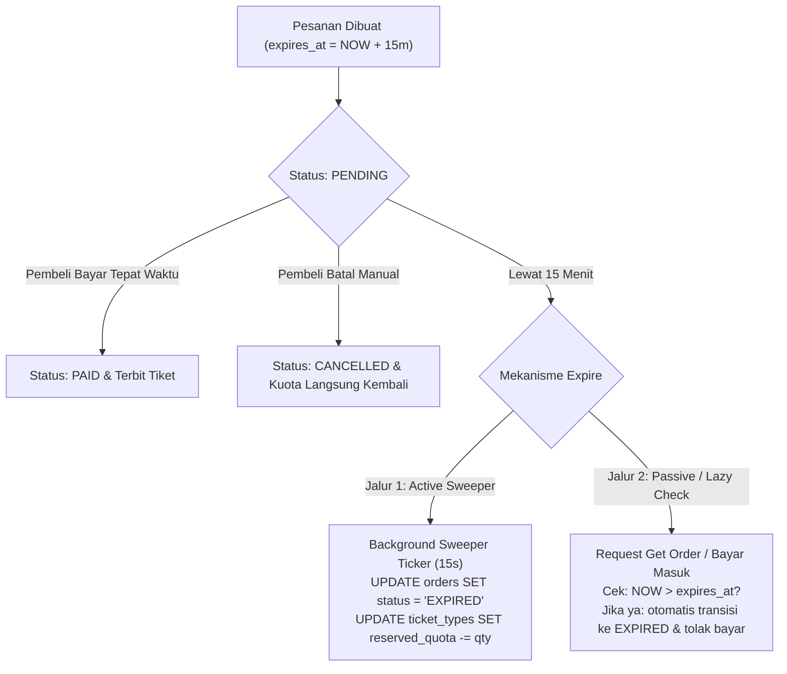

# Architectural Decisions & Analysis (DECISIONS.md)

Dokumen ini mendokumentasikan keputusan arsitektural, analisis masalah konkurensi, strategi pencegahan *overselling*, penanganan idempotensi, serta *trade-off* teknis yang diambil dalam pembangunan Backend API Penjualan Tiket Event.

---

## 1. Arsitektur Sistem: Modular Monolith vs Microservices

### Keputusan:
Sistem dibangun menggunakan pola **Modular Monolith** dalam satu container Node.js/TypeScript bersama PostgreSQL sebagai *single source of truth*.

### Alasan & Analisis:
1. **Integritas Transaksional (ACID Guarantees):**
   - Penjualan tiket dengan kuota terbatas adalah permasalahan transaksional kritis (*strong consistency*).
   - Dalam arsitektur microservices, memisahkan Order Service, Inventory/Quota Service, dan Payment Service membutuhkan *distributed transactions* (seperti 2-Phase Commit atau Saga Pattern). Saga pattern hanya menawarkan *eventual consistency*, yang rentan mengalami *overselling* saat lonjakan pesanan terjadi dalam detik yang sama.
   - Monolith memungkinkan eksekusi transaksi database lokal (`BEGIN ... COMMIT`) yang 100% ACID tanpa overhead jaringan antar-layanan.
2. **Kesesuaian Batasan Kasus:**
   - Aturan proyek secara eksplisit menyatakan *"Tidak ada VPS dan tidak ada microservice"*. Modular Monolith memberikan modularitas kode (pemisahan folder `events`, `orders`, `payments`, `users`) tanpa kompleksitas operasional infrastruktur terdistribusi.

### Trade-off:
- *Yang Dikorbankan:* Skalabilitas independen per komponen (misal: scaling inventory terpisah dari order).
- *Yang Didapat:* Keandalan data mutlak, latency transaksi ultra-rendah (<5ms per request), kemudahan debugging, serta kesederhanaan deployment satu perintah (`docker compose up`).

---

## 2. Strategi Penjualan Kuota & Pencegahan Oversell (Nilai Tambah #2: 200 Request Bersamaan)

### Masalah Konkurensi:
Ketika 200 pembeli menekan tombol "Beli" secara serentak pada sisa kuota 100 tiket, *race condition* (Read-Modify-Write anomaly) dapat terjadi:
- Request A membaca `sisa = 1`
- Request B membaca `sisa = 1`
- Request A memesan 1 tiket $\rightarrow$ sisa menjadi 0
- Request B memesan 1 tiket $\rightarrow$ sisa menjadi -1 (**Oversell**)

### Keputusan Teknis:
Kombinasi **Pessimistic Row-Level Locking**, **Atomic Conditional Update**, dan **Database-Level CHECK Constraints**.

```sql
-- Query Reservasi Kuota Atomik (orders.service.ts)
UPDATE ticket_types 
SET reserved_quota = reserved_quota + CAST($1 AS int) 
WHERE id = $2 
  AND event_id = $3 
  AND (total_quota - reserved_quota - sold_quota) >= CAST($1 AS int)
RETURNING id, name, price, total_quota, reserved_quota, sold_quota;
```

### Mengapa Pendekatan Ini Dipilih vs Alternatif Lain?

| Pendekatan | Mekanisme | Kelebihan | Kelemahan & Alasan Ditolak |
| :--- | :--- | :--- | :--- |
| **Atomic Conditional Update (Dipilih)** | Operasi `UPDATE` dengan klausa `WHERE remaining >= requested` | Mengunci baris secara eksklusif hanya pada milidetik eksekusi update, zero round-trip tambahan, dan mustahil oversell | Sedikit lebih ketat pada logika query SQL, tetapi paling andal |
| **Optimistic Locking (Version column)** | Cek kolom `version` saat update; retry jika version berubah | Bagus untuk sistem *low contention* | **Gagal pada Flash Sale:** 200 request bersamaan akan memicu 150+ conflict abort / CPU retry spike |
| **Distributed Lock (Redis / Redlock)** | Lock mutex di Redis sebelum query database | Menahan request di layer cache | Menambah single point of failure (SPOF); risiko split-brain jika Redis restart atau jaringan desinkronisasi dengan DB |

### Jaminan Keamanan Multi-Lapis (Defense-in-Depth):
1. **Lapis Database Constraint:**  
   `CONSTRAINT chk_total_quota CHECK (reserved_quota + sold_quota <= total_quota AND reserved_quota >= 0 AND sold_quota >= 0)`  
   Bahkan jika terjadi *bug* pada kode aplikasi, database PostgreSQL secara fisik menolak transaksi yang melanggar kuota.
2. **Pencegahan Deadlock:**  
   Ketika satu pesanan memesan lebih dari satu tipe tiket, ID tipe tiket selalu diurutkan secara leksikografis (`sortedItems.sort()`) sebelum lock diambil. Ini menghilangkan siklus saling tunggu (*circular wait condition*).

---

## 3. Penegakan Batas Maksimal 4 Tiket per Pembeli per Event (Rule 4)

### Aturan Bisnis:
Satu pembeli hanya diperbolehkan memiliki maksimal 4 tiket per event, dihitung dari semua pesanan aktif (`PENDING` yang belum expired) atau sudah lunas (`PAID`).

### Implementasi:
Di dalam blok transaksi pemesanan:
```sql
SELECT COALESCE(SUM(oi.quantity), 0) AS total_buyer_tickets
FROM orders o
JOIN order_items oi ON o.id = oi.order_id
WHERE o.user_id = $1 
  AND o.event_id = $2
  AND (o.status = 'PAID' OR (o.status = 'PENDING' AND o.expires_at > $3));
```
- Jika `total_buyer_tickets + requested_qty > 4`, transaksi di-rollback seketika dengan status `400 Bad Request`.
- Pesanan berstatus `PENDING` yang telah melewati `expires_at` secara dinamis diabaikan dari perhitungan kuota pengguna.

---

## 4. Mekanisme Kedaluwarsa 15 Menit (Dual-Layer Strategy)

### Keputusan:
Pendekatan dua lapis (**Dual-Layer Expiration**): **Active Sweeper Worker** + **Passive Lazy Evaluation**.



### Mengapa Dua Lapis?
1. **Active Sweeper (`expiry.worker.ts`):**  
   Interval timer internal berjalan berkala (default 15 detik). Menyisir pesanan `PENDING` yang telah lewat batas waktu, mengembalikan `reserved_quota`, dan mengubah status ke `EXPIRED`.
2. **Passive Lazy Evaluation (`orders.service.ts` & `payments.service.ts`):**  
   Jika sweeper belum sempat berjalan pada detik ke-15:01 dan sebuah request (atau webhook) masuk, sistem langsung mengevaluasi `expires_at <= NOW()`. Status pesanan dieksekusi menjadi `EXPIRED` saat itu juga dan pembayaran ditolak.
3. **Mengapa Bukan Message Queue (RabbitMQ / Kafka) atau Redis Keyspace Notifications?**
   - Redis TTL Notification tidak menjamin pengiriman tepat waktu saat beban tinggi (*fire-and-forget*).
   - Solusi database-backed ini mempertahankan state bahkan jika server restart (*crash-resilient*).

---

## 5. Webhook Pembayaran Idempoten & Kasus Tepi (Nilai Tambah #1)

Penyedia pembayaran riil (seperti Midtrans, Xendit, Stripe) menggunakan model *at-least-once delivery*, di mana notifikasi HTTP bisa dikirim berulang kali.

### Strategi Idempotensi:
1. **Tabel Log Idempotensi (`payment_webhooks`):**
   Kolom `payment_reference` diberi indeks `UNIQUE`.
2. **Penanganan Kasus Tepi:**
   - **Pesan Duplikat / Retry Jaringan:**  
     Jika webhook dengan `payment_reference` yang sama tiba kembali, sistem mengecek tabel log dan langsung merespons `200 OK` dengan payload tiket yang sudah ada (`code: ALREADY_PROCESSED`). Tidak ada duplikasi tiket.
   - **Webhook Terlambat (Tiba Setelah Pesanan Expired):**  
     Jika webhook tiba setelah pesanan masuk masa kedaluwarsa atau dibatalkan, kuota tiket sudah dikembalikan ke pasar publik. Sistem **menolak** penerbitan tiket (`code: ORDER_EXPIRED`), menandai log untuk *manual refund*, dan merespons dengan status `422 Unprocessable Entity`.
   - **Satu Pesanan Tidak Boleh Terbit Tiket Ganda:**  
     Di dalam transaksi database, status pesanan dikunci dengan `FOR UPDATE`. Transisi hanya diizinkan dari `PENDING` $\rightarrow$ `PAID`. Jika pesanan sudah `PAID`, penerbitan tiket dilewati.

---

## 6. Model Invarian Kuota Tiket

Untuk menjamin konsistensi matematis di seluruh siklus hidup tiket:

$$\text{Total Quota} = \text{Available Quota} + \text{Reserved Quota} + \text{Sold Quota}$$

- **Saat Pembuatan Event:** `available = total`, `reserved = 0`, `sold = 0`.
- **Saat Pesanan Masuk (Pending):** `reserved += qty`, `available -= qty`.
- **Saat Pesanan Batal / Expired:** `reserved -= qty`, `available += qty`.
- **Saat Pembayaran Sukses:** `reserved -= qty`, `sold += qty` (Nilai `available` tidak berubah).

Invarian matematis ini dijamin oleh fungsi transaksi dan *PostgreSQL Check Constraints*.

---

## 7. Desain CI/CD Pipeline & Containerization

### Docker Multi-Stage Build:
- **Stage 1 (Builder):** Melakukan instalasi seluruh *devDependencies* dan melakukan kompilasi TypeScript (`tsc`).
- **Stage 2 (Runner):** Menggunakan image minimalis `node:22-alpine`, hanya menginstal *production dependencies* (`npm ci --only=production`), menyalin artefak `dist/`, dan dijalankan dengan user non-root (`USER node`) untuk keamanan.

### Pipeline GitHub Actions:
- **Automated Tests:** Berjalan otomatis di setiap `push` dan `pull_request` dengan container layanan PostgreSQL riil.
- **Commit SHA Tagging:** Setiap image yang lolos pengujian di-build dan di-push ke GitHub Container Registry (`ghcr.io`) dengan dua tag:
  1. `:${{ github.sha }}` (Immutability & traceability terhadap commit spesifik).
  2. `:latest` (Convenience tag).
